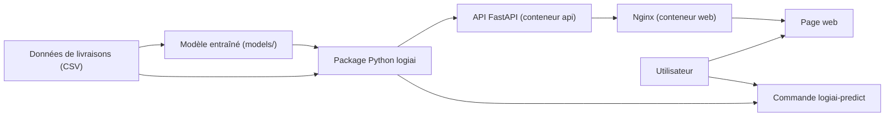

# Étude de conception — LogiAI

## besoin

À compléter.

## données

À compléter.

## modèle et métriques

À compléter.

## critères d'acceptation

À compléter.

## cycle de vie

À compléter.

## architecture

Le package `logiai`, installé dans l'environnement Python du conteneur API,
charge les données et le modèle stockés sous `LOGIAI_HOME`. Il expose
`logiai-predict` pour une utilisation locale et fournit les fonctions utilisées
par l'API FastAPI. Nginx sert la page web dans un conteneur séparé ; la page
appelle l'API publiée sur le port 8000. `docker compose` orchestre les
conteneurs API et web.

## choix technologiques

À compléter.

## risques et éthique

À compléter.

## limites

À compléter.
